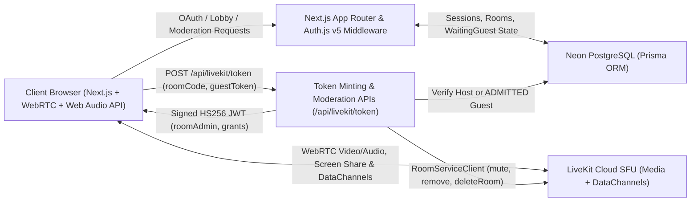

# KOVA — Architectural Video Conferencing

> **GREAT COMMUNICATION BEGINS WITH CONNECTION**

Kova is a precision, low-latency WebRTC video conferencing platform engineered with Next.js 15, LiveKit Cloud, Prisma, and Auth.js v5. Designed around a **Luminous Obsidian (`#09090B`) & Champagne Gold (`#F2C594`)** dark aesthetic alongside a **Warm Alabaster (`#FAF9F6`)** light mode, Kova eliminates visual noise and centers every interaction around speed, security, and audio-video clarity.

---

## Core Engineering Highlights

- **Server-Minted LiveKit JWT Grants:** Access tokens are generated exclusively on the server (`POST /api/livekit/token`) using `livekit-server-sdk`. Tokens encode per-room permissions (`canPublish`, `canSubscribe`, `canPublishData`, `roomAdmin: isHost`) and append a unique 6-character session suffix (`${baseIdentity}:${suffix}`) so multi-tab logins on the same account never collide.
- **Waiting Room State Machine (`WAITING` → `ADMITTED` / `REJECTED`):** Unauthenticated guests knock via `POST /api/meetings/[roomCode]/knock` to receive an ephemeral `guestToken`, poll status cleanly, and are strictly blocked at both the Next.js server page boundary (`/m/[roomCode]`) and the LiveKit token API until admitted by the host.
- **Web Audio API Green-Room Diagnostics:** The pre-join lobby (`/m/[roomCode]/lobby`) requests `getUserMedia` video/audio streams, mirrors local camera output, populates hot-swappable device selectors (`enumerateDevices` + `devicechange`), and renders a zero-re-render 60fps `AudioContext` + `AnalyserNode` RMS microphone volume meter.
- **LiveKit DataChannel Collaboration:** Ephemeral in-call messaging (`topic: "kova-chat"` with safe URL auto-linking and unread badges) and synchronized hand-raising (`topic: "kova-signal"` with late-joiner state sync) run peer-to-peer over WebRTC DataChannels with zero database overhead.
- **Host Moderation & Room Lifecycle:** Protected moderation APIs let hosts lock/unlock rooms mid-call, toggle waiting rooms, mute or remove connected participants via `RoomServiceClient`, and delete LiveKit Cloud rooms on call end.
- **Dual-Theme Design System:** Built on `Outfit`, `Manrope`, and `JetBrains Mono` (`tabular-nums`) with CSS variables, Tailwind v4 class-based theme switching (`next-themes`), and tactile keyboard shortcuts (`M`, `V`, `C`, `H`).

---

## Tech Stack

| Layer | Technology | Role |
| :--- | :--- | :--- |
| **Framework** | Next.js 15 (App Router) | Server Components, Route Handlers, Server Actions, Edge Middleware |
| **Language** | TypeScript 5 | End-to-end strict type safety |
| **Styling & Theme** | Tailwind CSS v4 + `next-themes` | Dual-theme Luminous Obsidian & Warm Alabaster token system |
| **Database & ORM** | Neon PostgreSQL + Prisma 6 | Relational schema for users, rooms, and waiting guest admission state |
| **Authentication** | Auth.js v5 (`next-auth@beta`) + `@auth/prisma-adapter` | Google OAuth 2.0 with Edge-compatible JWT strategy |
| **WebRTC & Media** | LiveKit Cloud (`livekit-server-sdk`, `livekit-client`, `@livekit/components-react`) | Selective Forwarding Unit (SFU), screen sharing, DataChannels, moderation RPC |
| **Icons** | Lucide React | Uniform `1.75px` stroke iconography |

---

## System Architecture



---

## Product Showcase

| Landing Hero | Host Dashboard |
| :---: | :---: |
|  |  |
| **Pre-Join Green Room** | **Live Video Room** |
|  |  |

---

## Environment Variables

Create a `.env` file in the project root with the following variables:

| Variable | Required | Description |
| :--- | :---: | :--- |
| `DATABASE_URL` | Yes | PostgreSQL connection string (e.g. Neon pooled connection URI) |
| `AUTH_SECRET` | Yes | Random 32+ character secret used by Auth.js v5 to sign session JWTs |
| `AUTH_GOOGLE_ID` | Yes | Google OAuth 2.0 Client ID |
| `AUTH_GOOGLE_SECRET` | Yes | Google OAuth 2.0 Client Secret |
| `LIVEKIT_URL` | Yes | LiveKit Cloud WebSocket URL (e.g. `wss://your-project.livekit.cloud`) — `NEXT_PUBLIC_LIVEKIT_URL` is also supported |
| `LIVEKIT_API_KEY` | Yes | LiveKit Cloud API Key matching your project |
| `LIVEKIT_API_SECRET` | Yes | LiveKit Cloud API Secret matching your project |

---

## Local Setup

1. **Install dependencies:**
   ```bash
   npm install
   ```

2. **Configure environment variables:**
   Populate `.env` using the table above. Ensure `http://localhost:3000/api/auth/callback/google` is added to your Google Cloud OAuth Authorized Redirect URIs.

3. **Sync database schema & generate Prisma Client:**
   ```bash
   npx prisma db push
   npx prisma generate
   ```

4. **Start the development server:**
   ```bash
   npm run dev
   ```

5. **Open the app:**
   Visit [http://localhost:3000](http://localhost:3000).

---

## Production Build & Vercel Deployment

The `build` script runs `prisma generate && next build` automatically to ensure `@prisma/client` is freshly generated in CI/CD environments.

1. Set all environment variables from the table above in your Vercel project settings.
2. Add your production callback URL (`https://<your-domain>/api/auth/callback/google`) to Google Cloud Console.
3. Deploy — `trustHost: true` is configured in Auth.js (`src/auth.config.ts` and `src/auth.ts`) for reverse-proxy host resolution.
